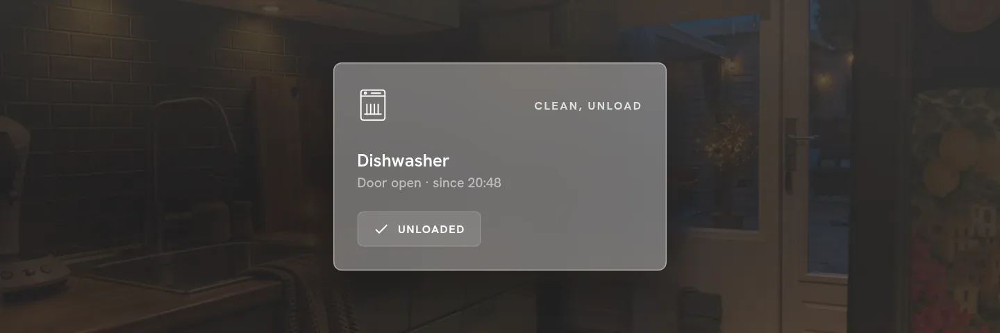

# Cards

Every entity in a room becomes a card. A card shows its icon top left, its state top right, the name and a short line in the middle, and an optional extra line at the bottom.

**Tap and hold.** By default lights and switches **toggle on tap** and open details on **hold**. Everything else opens details on tap. Media, covers and thermostats also have buttons right on the card. You can change all of this per card or per card type: see [Card settings](card-settings.md).

## Lights

<div class="grid2" markdown>
<figure markdown>

<figcaption>On, with brightness steps</figcaption>
</figure>
<figure markdown>

<figcaption>Off</figcaption>
</figure>
</div>

A thin vertical bar on the right sets the brightness (drag it; dragging to 0 turns the light off). The bottom line can show:

| bottom | shows |
|---|---|
| auto | brightness steps (25, 50, 75, 100) when the light is dimmable |
| steps | always the brightness steps |
| colors | colour dots; lights with only colour temperature get warm, neutral and cool |
| today | 24 hourly bars of when the light was on today |
| none | nothing |

## Switches and smart plugs

<div class="grid2" markdown>
<figure markdown>

<figcaption>A plain switch</figcaption>
</figure>
<figure markdown>

<figcaption>A plug with a power meter</figcaption>
</figure>
</div>

A switch toggles on tap. A switch whose device also reports **power** becomes a plug card: live watts big, kWh used today, and a three-hour sparkline. The bottom line can also be a **timer** (switch off after 15, 30, 60 … minutes), the **cost** today (set your price under *Settings → Energy*), or hourly **bars**. You can link a power sensor by hand when it lives on another device.

<div class="grid2" markdown>
<figure markdown>

<figcaption>A power strip: one button per outlet</figcaption>
</figure>
</div>

## Appliances

<div class="grid2" markdown>
<figure markdown>

<figcaption>A dishwasher (Home Connect) with programme, progress and Stop</figcaption>
</figure>
</div>

Washing machines, dishwashers and dryers are recognised in two ways:

- a device that reports its own status (Home Connect, Miele, LG ThinQ …): the card shows the programme, progress, finish time and door, with a **Stop** button;
- a smart plug with a power meter: *busy* above a threshold (5 W by default, adjustable per card), *done* when it drops, *standby* otherwise.

## Litter box

A power strip whose device is named like a litter box (Kattenbak, litter, cat box), or whose switches are Clean, Empty and Deodorize, gets its own card instead of the plain power strip.

- **Corner:** the state, not a percentage: the weight (for example "5,9 kg"), "Reinigt…" or "Leegt…" while it runs, and "Afvalbak vol" when the bin is full.
- **Middle:** the name, and under it the modes that are on (Ontgeuren, Auto-ontgeuren …) or "All off".
- **Bottom row:** one icon button per switch, in the order Clean, Empty, Smart clean, Deodorize, Auto-deodorize, Odourless. A button toggles its switch on tap and opens the switch's details on hold; the name is the tooltip. The row sits where a light's brightness steps sit, so the name keeps the height of the other cards.
- **Tap on the card:** a popup with Clean and Empty, the weight, the bin, the lifetime and every switch.

## Media

<div class="grid2" markdown>
<figure markdown>

<figcaption>Music with artwork</figcaption>
</figure>
<figure markdown>

<figcaption>A TV app without artwork gets the app's colours</figcaption>
</figure>
</div>

Artwork as the card background, title and artist, and previous / play-pause / next on the card. When the same TV appears through several integrations (Android TV, Cast, Bravia), they are merged into one card.

## Climate

<div class="grid2" markdown>
<figure markdown>

<figcaption>Current temperature, target, modes and the rail</figcaption>
</figure>
</div>

The current temperature big, the name below it, and a rail on the right to drag the target up and down (the knob shows the target). Under the name: the target, plus one extra item you pick under **Bottom line** in the card settings: humidity or the active preset (automatic), the time spent heating today, the outside temperature (from the weather entity), or nothing. On phones only that extra item is shown, at the bottom. HVAC modes sit in a row at the bottom. The popup lists every room's temperature.

## Covers and fans

<div class="grid2" markdown>
<figure markdown>

<figcaption>Cover: up and down</figcaption>
</figure>
<figure markdown>

<figcaption>Fan: the bar sets the speed</figcaption>
</figure>
</div>

- **Covers**: up and down buttons; covers with a position get the vertical bar.
- **Fans**: vertical bar for speed, presets and oscillation in the popup.

## Locks, vacuums and humidifiers

<div class="grid2" markdown>
<figure markdown>

<figcaption>Lock: tap to lock or unlock</figcaption>
</figure>
<figure markdown>

<figcaption>Vacuum: start / pause and dock</figcaption>
</figure>
<figure markdown>

<figcaption>Humidifier: target up and down</figcaption>
</figure>
</div>

## Sensors

<div class="grid2" markdown>
<figure markdown>

<figcaption>Door, with how long it has been open</figcaption>
</figure>
<figure markdown>

<figcaption>Motion</figcaption>
</figure>
</div>

Doors, windows, motion, smoke, leak and other binary sensors show their state and how long it has been that way ("Closed · since 08:51"). Their bottom line can show **today**: when they were active, as bars. Battery-powered sensors can show the battery level in the corner. A sensor with a missing or wrong device class gets the right card through **Kind** in its card settings.

**Value cards.** A plain sensor (temperature, humidity, power, a percentage, a text) does not get a card by itself; add one in [edit mode](rooms.md#edit-mode) → *Add card*. The number is shown large with its unit, the name under it, the kind in the corner and the last change at the bottom. Text sensors show their text instead. Tap for the details, hold for Home Assistant's dialog; action buttons and the template overrides work as on other cards.

## Cameras

<div class="grid2" markdown>
<figure markdown>

<figcaption>A live snapshot</figcaption>
</figure>
</div>

A live snapshot that refreshes every few seconds without flicker; tap for the stream and the motion events of the last 24 hours.

## Home view cards

<div class="grid2" markdown>
<figure markdown>

<figcaption>Attention: unavailable devices, low batteries, updates and notifications</figcaption>
</figure>
<figure markdown>

<figcaption>Weather: condition, temperature and a rain heads-up</figcaption>
</figure>
<figure markdown>

<figcaption>Waste: the next pickups</figcaption>
</figure>
<figure markdown>

<figcaption>Agenda: the next events from your calendars</figcaption>
</figure>
<figure markdown>

<figcaption>Scenes: your favourite scenes as buttons</figcaption>
</figure>
<figure markdown>

<figcaption>Energy: power now and today's use</figcaption>
</figure>
</div>

Waste pickups work with the Afvalbeheer and Afvalwijzer integrations and any sensor with a date. The weather card shows on the home view when the weather block in the header is hidden (on phones, for example), or always with **Settings → Home page → Weather card**.

## Groups

**Settings → Groups** combines several lights, switches or plugs into one card, placed in a room or on the home view. Style *tiles* shows a master switch with a chip per member; *list* shows the members as rows.

## Graphs

**Settings → Graphs** adds a card with a line of one numeric sensor (temperature, humidity, power, …) over the last 3 hours to 7 days, placed in a room or on the home view. The corner shows the current value, the line under it the trend, and the subtitle the average and the range for the period. Tapping opens the Home Assistant history dialog of the sensor. Name, icon and tap behaviour can be changed per card like on any other card.

Door, window and motion cards can take the same layout: set **Bottom** to *graph (on/off line)* in the card's ⋯ settings (or for all of them under **Settings → Card defaults**). The line then steps between off and on over the last 24 hours, with today's total on the bottom line.

## Claude Code and ChatGPT usage

Two cards with your AI usage, **Claude Code** and **ChatGPT**, built the same way. The corner shows the **time left of the 5-hour session** (for example "2 u 55 min"), the way a litter box shows its weight. Under the name, in amber, a notice appears when you have used more than the elapsed part of the window allows (10 points ahead: *ahead of schedule*), when the sensors have not updated for half an hour (*outdated*) or when the integration reports an error. At the bottom, two meters: the **5-hour session** and the **weekly limit**, each with the percentage used and a tick on the bar for how far the window's time has run. A meter turns amber from 70 % and red from 90 %. On phones and in two rows the notice line is left out and the meters get smaller. Tap a card for the popup: both windows with their reset time, the pace, when the data was last updated and the history of the last 24 hours (session) and 7 days (week).

The numbers come from sensors in Home Assistant, from a usage integration or your own template sensors, per provider:

| sensor | what |
|---|---|
| `sensor.claude_5_h_session`, `sensor.chatgpt_5_h_session` | percentage used in the 5-hour window; its `session_resets_at` attribute is the reset time |
| `sensor.claude_week`, `sensor.chatgpt_week` | percentage used of the weekly limit; its `weekly_resets_at` attribute is the reset time |
| `sensor.claude_5_h_reset`, `sensor.claude_week_reset` (and the same for `chatgpt`) | optional: the reset as text (`17:50`, `29/10 00:00`), used when the attribute is missing |

The cards find the sensors by name (an entity id with `claude` or `chatgpt`, then `session`/`5h` or `week`). If yours are named differently, pick them under **Settings → AI usage**. Add a card with **Edit → Add card → Tomte cards → Claude Code** (or **ChatGPT**); an entry only shows when its sensors exist. Name and icon can be changed like on any card (⋯ → Card settings).

## Light scenes

<div class="grid2" markdown>
<figure markdown>

<figcaption>Light scenes: save and recall the room's lights</figcaption>
</figure>
</div>

Every room with lights gets a **Light scenes** card. Save the current state of the room's lights (on/off, brightness, colour) as a preset and recall it with one tap.

## Template cards

<div class="grid2" markdown>
<figure markdown>

<figcaption>A template card showing the weather state</figcaption>
</figure>
</div>

**Settings → Template cards** is a **library** of cards whose text, label and visibility condition are **Jinja templates**, rendered live by Home Assistant. A template gets a name, an icon and a tap action (details, toggle, a service call or navigation). The entity is not part of the template: you pick it when you place the card, and write `$entity` wherever it goes:

```jinja
{{ states('$entity') | int }} days        ← text
{{ states('$entity') | int < 10 }}        ← visible
```

Under **Filled in when placing** you mark which fields (text, label, visibility) the card asks for when it is placed; what you type in the template is then the example. You place a template through [edit mode](rooms.md#edit-mode) → **Add card → Template**: pick the entity, fill in the asked fields, done. The same template can be placed as often as you like; each copy keeps its own values, name and icon in its card settings.

You do not have to go through the settings page: **Add card → Template → New template card** writes a template right there, with a choice between **once, only here** (the definition travels with that one card; its texts are edited in the card settings) and **in my library too** (saved as a reusable template as well). Template cards that were pinned to a page before 3.1 are moved to that page's cards automatically.

!!! note
    Templates are rendered by Home Assistant's template websocket, which needs an administrator account.
